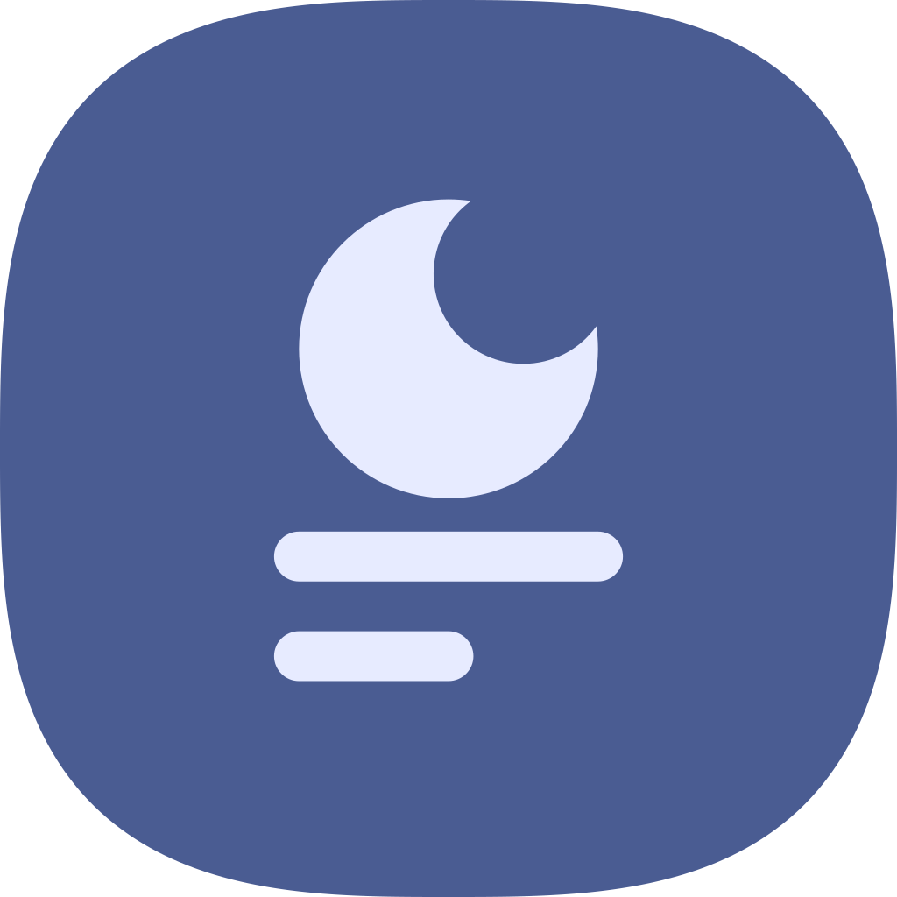

<div align="center">
  
</div>

<h1 align="center">FallAsleep Timetable</h1>

<p align="center">
  The offline, ad-free, completely free Material You timetable.
</p>

<p align="center">
  🌐&nbsp;
  <a href="README.md"><kbd>🇨🇳 简体中文</kbd></a>&nbsp;
  <a href="README.en.md"><kbd>🇬🇧 English ✓</kbd></a>&nbsp;
  <a href="README.ja.md"><kbd>🇯🇵 日本語</kbd></a>
</p>

---

## Tomo is SO done with checking the timetable on the go and getting yanked into some other app!!!

Done with splash ads! Done with shake-to-jump! Done with over-designed screens! Done with shameless membership nagging!!!

So here it is: a completely offline, featherweight, ad-free, absolutely free, long-term-maintained Material You timetable!

> Current beta: **v1.1.1-beta1** · Stable: v1.1.0 · Android 8.0+ · arm64-v8a

## Tomo says: use FallAsleep Timetable!

- **No ads, completely free**: no ad slots, no subscriptions, no accounts, no backend of our own.
- **Fully offline**: timetable, settings and backups all live on your device.
- **Material 3 design**: Android 12+ picks up your wallpaper colors; fixed accent colors and dark mode are also supported.
- **Phone and tablet ready**: bottom navigation on phones, a side rail plus a two-pane timetable and Today view on tablets.
- **Native Kotlin**: built with Jetpack Compose — light, clean, no WebView shell.

## Features

### Timetable

- Multiple timetables: keep your main, lab and exam-prep schedules apart and switch whenever you like.
- Weeks: jumps to the current week automatically, previous/next week, and "This week" to snap back.
- Course cards: week range, odd/even weeks, back-to-back periods, color, teacher, room and notes.
- Class times are stored per timetable: each timetable gets its own period count and start/end times, with a one-tap "apply to all timetables" option.
- Today page: a timeline of today's classes; finished classes fade out.
- Fullscreen timetable: hide system bars and UI chrome, let the grid take over.
- Course detail sheet and helpful empty states.

### Import

- **Academic system import**: a built-in WebView for manual login; grab the timetable page and parse it locally.
  - Supports new Zhengfang (jwglxt), old Zhengfang and Qiangzhi templates, detected automatically.
  - Optionally overwrite the current timetable while keeping its existing class-time setup.
- **File import**: JSON backup, ICS calendar, CSV spreadsheet and the legacy `.wakeup_schedule`.
- If a JSON backup carries term settings, you can restore the start date, week count and class times together.

### Share & export

The "Share & export" button at the top right of the home page brings everything together:

- Share a long timetable image: this week or the whole term, with theme, teacher and room toggles.
- Export a JSON backup or a CSV spreadsheet.
- Import a timetable file.

Settings → Data:

- Export a calendar (.ics).
- Import into the calendar: writes to the system calendar and lets the system handle reminders.

### Home screen widgets

- Today's classes: adapts to widget width — today / today + tomorrow / three days.
- Week timetable: pinned to the current week, overlapping classes in separate lanes, today's column in bold.
- Each widget can pick its own timetable, toggle teacher/room and show upcoming days.
- Refreshes within a minute after class ends (needs "Alarms & reminders"; otherwise the system's periodic refresh).
- Monet colors on Android 12+.

### Motion & system

- Tablet week switch: the timetable and Today panel slide and fade independently.
- Predictive back: Today / Settings slide away to reveal the timetable underneath.
- Fullscreen zoom, the FAB's plus rotating into an X, a haptic tick when switching weeks.

### Other

- Update checks: GitHub by default, with a China mirror (gh-proxy for the API and APK download); a home-page snackbar when an update is available, with opt-out/opt-in and a Beta plan.
- Dark mode (follow system / light / dark, widgets included), custom accent color, font scaling and TalkBack course descriptions.

## Download & install

Stable releases live in [Releases](https://github.com/tukinokilyowsoo/FallAsleepTimetable/releases/latest):

- File: `FallAsleepTimetable_arm64_v1.1.0.apk`
- Architecture: arm64-v8a (most recent phones and tablets)
- Size: about 11 MB
- SHA-256: `d100826ca05a46f51ceca6e6ff21af0c9dc0427d44499e2ede6c32c8de3f8ccd`

Betas are marked as Pre-release in Releases:

- Version: `v1.1.1-beta1`
- File: `FallAsleepTimetable_arm64_v1.1.1-beta1.apk`
- SHA-256: `bc43fd7f4845bdb690985ae641e6aeb9d23a126b9d0fb5ed93f5e9b2ccf570eb`

You can join the Beta plan from Settings → About → Check for updates to receive future betas.

Notes:

- The app uses its own release signing key. If you previously installed a **debug** build, export your JSON first, uninstall, then install the release; users on older release test builds can upgrade in place.
- Package name: `io.github.tukinokilyowsoo.fallasleeptimetable`. The package changed in beta2, so it can coexist with older versions; data is not shared — export JSON and import it.

## Requirements

- Android 8.0 (API 26) or newer
- arm64-v8a
- Timetable and widgets work offline; academic-system import needs a network connection

## Known issues

- Academic-system redesigns can break parsing; use "Export log" to send us an HTML snippet.
- Parsing templates cover Zhengfang (new / old) and Qiangzhi; other systems are not supported yet.
- Precise post-class widget refresh relies on the "Alarms & reminders" permission; without it, widgets refresh at most about every 30 minutes.
- The full predictive-back gesture animation needs Android 13+; older systems behave the same but without the preview animation.

## Privacy

- No account, no backend, no analytics SDK.
- Academic-system login happens only inside the in-app WebView session; student IDs and passwords are never saved.
- Some school systems only offer HTTP; the import WebView therefore allows cleartext connections. The timetable, settings and update checks never use cleartext.
- See [PRIVACY.md](PRIVACY.md) for details.

## Tech stack

- Kotlin + Jetpack Compose + Material 3
- `material3-adaptive-navigation-suite` (adaptive NavigationBar / Rail / Drawer)
- Room + DataStore for local storage
- Glance home screen widgets
- jsoup for parsing academic-system pages
- minSdk 26, targetSdk / compileSdk 36
- Dynamic color (Android 12+) with built-in light/dark fallbacks

## Project layout

```
app/src/main/java/io/github/fallasleeptimetable/
├── MainActivity.kt
├── data/            # Room, import parsers, calendar, sharing, update checks
├── domain/          # timetable models, week/layout logic
├── ui/              # Compose navigation, timetable / today / settings, theme
└── widget/          # Glance home screen widgets
```

## Development & docs

- [M0 notes](docs/M0-记录.md) / [M1 notes](docs/M1-记录.md) / [M2 notes](docs/M2-记录.md) / [M3 notes](docs/M3-记录.md)
- [v1.1.0 release notes](docs/RELEASE-NOTES-v1.1.0.md)
- [v1.0.0 release notes](docs/RELEASE-NOTES-v1.0.0.md)
- [Third-party notices](THIRD-PARTY-NOTICES.md)
- [Privacy policy](PRIVACY.md)

## License

This project uses the [PolyForm Noncommercial License 1.0.0](LICENSE):

- Personal study, research, testing and hobby projects are allowed for **non-commercial use**;
- Non-commercial modification and redistribution are allowed, but the license text and Required Notice must be included;

> This is not an OSI-approved open-source license.

## Feedback

- Bugs and ideas: [GitHub Issues](https://github.com/tukinokilyowsoo/FallAsleepTimetable/issues)
- You can also leave a note on Xiaohongshu.

---

© 2026 槻ノ木 響子 · Lyowsoo
