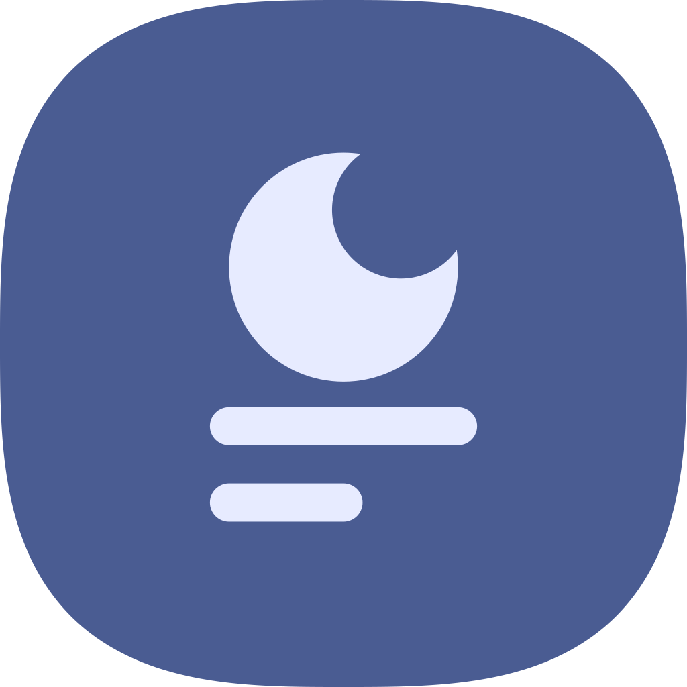

<div align="center">
  
</div>

<h1 align="center">FallAsleep 時間割</h1>

<p align="center">
  オフライン・広告なし・完全無料の Material You 時間割。
</p>

<p align="center">
  🌐&nbsp;
  <a href="README.md"><kbd>🇨🇳 简体中文</kbd></a>&nbsp;
  <a href="README.en.md"><kbd>🇬🇧 English</kbd></a>&nbsp;
  <a href="README.ja.md"><kbd>🇯🇵 日本語 ✓</kbd></a>
</p>

---

## Tomo は、移動中に時間割を見ようとしたら別のアプリに飛ばされる生活に、もううんざり！！！

起動広告もうんざり！シェイクでジャンプもうんざり！ゴチャゴチャした画面もうんざり！図々しい会員誘導もうんざり！！！

というわけで、完全オフライン・超軽量・広告なし・完全無料・長期メンテの Material You 時間割ができました！

> 現在のバージョン：**v1.2.0** · Android 8.0+ · arm64-v8a

## Tomo のおすすめは FallAsleep 時間割！

- **広告なし、完全無料**：広告枠もサブスクもアカウントもなし。自前のサーバーもありません。
- **完全オフライン**：時間割・設定・バックアップはすべて端末の中に。
- **Material 3 デザイン**：Android 12+ は壁紙の色を拾います。固定テーマ色とダークモードにも対応。
- **スマホもタブレットも快適**：スマホは下部ナビ、タブレットはサイドレール＋時間割と今日の2ペイン。
- **ネイティブ Kotlin**：Jetpack Compose 製。軽くてすっきり、WebView の殻ではありません。

## 機能

### 時間割

- 複数の時間割：メイン、実験、受験対策などを分けて管理し、いつでも切り替え。
- 週：今週を自動で表示。前週／次週、「今週」で一発戻り。
- コマ：開始・終了週、奇数週／偶数週、連続コマ、色、教員、教室、メモ。
- 授業時間は時間割ごとに保存：コマ数と開始・終了時刻を個別に設定でき、「すべての時間割に適用」もワンタップ。
- 今日ページ：今日の授業をタイムライン表示。終わった授業はグレーに。
- 全画面時間割：システムバーと UI を隠して、時間割を画面いっぱいに。
- 授業詳細シート、空状態のやさしい案内。

### インポート

- **教務システム取り込み**：内蔵 WebView で手動ログインし、現在の時間割ページを取得して端末内で解析。
  - 新・旧正方（jwglxt）と強智の3テンプレートを自動判別。
  - PC版／モバイル版の UA を切り替え可能。PC でしか完全な時間割を出さない教務システムにも対応。
  - 現在の時間割を上書きし、既存の授業時間設定をそのまま引き継ぐことも可能。
- **ファイル取り込み**：JSON バックアップ、ICS カレンダー、CSV、旧 `.wakeup_schedule`。
- JSON に学期設定が入っていれば、開始日・週数・授業時間をまとめて復元できます。

### 共有とエクスポート

ホーム右上の「共有とエクスポート」に集約：

- 時間割の長い画像を共有：今週または学期全体、テーマ・教員／教室表示の切り替え付き。
- JSON バックアップ、CSV を書き出し。
- 時間割ファイルを取り込み。

設定 → データ：

- カレンダーを書き出し（.ics）。
- カレンダーへインポート：システムカレンダーに書き込み、リマインダーはシステムにお任せ。

### ホーム画面ウィジェット

- 今日の授業：ウィジェット幅に応じて、今日／今日＋明日／3日間を表示。
- 今日のタイムライン：今日の残りの授業を時系列で表示し、現在の授業を強調。
- 週時間割：今週固定、重なる授業はレーン分け、今日の列は太字。
- ウィジェットごとに時間割、教員／教室、先の日付表示を設定可能。
- 授業終了後1分以内に更新（「アラームとリマインダー」権限が必要。未許可ならシステムの定期更新）。
- Android 12+ の Monet カラー。

### アニメーションとシステム

- タブレットの週切り替え：時間割と今日パネルがそれぞれスライド＆フェード。
- 予測型戻る：今日／設定がスライドして、下の時間割が顔を出す。
- 全画面ズーム、FAB の＋が×に回転、週切り替えの小さな触覚フィードバック。

### その他

- 更新チェック：既定は GitHub、中国向けミラー（gh-proxy で API と APK を加速）付き。更新があればホームにスナックバー、通知の拒否／再開、Beta プランにも対応。
- ダークモード（システム追従／ライト／ダーク、ウィジェットも同期）、カスタムテーマ色（Material パレットのプリセット＋カラーホイール）、文字サイズ、TalkBack の授業説明。

## ダウンロードとインストール

安定版は [Releases](https://github.com/tukinokilyowsoo/FallAsleepTimetable/releases/latest) で公開しています：

- ファイル：`FallAsleepTimetable_arm64_v1.2.0.apk`
- アーキテクチャ：arm64-v8a（最近のスマホ・タブレットのほとんど）
- サイズ：約 10.5 MB
- SHA-256：`e299036edcc100e273158cbc3f4e0dc0dc5b5b34c8d25fa1bdb616e1b2b70858`

今後のベータ版は Pre-release として公開されます。設定 → 概要 →「アップデートを確認」から Beta プランに参加できます。

メモ：

- 独自の release 署名キーを使用しています。以前に **debug** 版を入れたことがある場合は、先に JSON を書き出してからアンインストールし、release 版を入れてください。旧 release テスト版からの上書き更新は可能です。
- パッケージ名：`io.github.tukinokilyowsoo.fallasleeptimetable`。beta2 でパッケージ名が変わったため、古いバージョンと共存できます。データは共有されないので、JSON を書き出して読み込み直してください。

## 動作環境

- Android 8.0（API 26）以上
- arm64-v8a
- 時間割とウィジェットはオフラインでも動作。教務システム取り込みにはネットワークが必要

## 既知の問題

- 教務システムの改版で解析できなくなることがあります。「ログを書き出す」からページの HTML 断片を送ってください。
- 解析テンプレートは正方（新／旧）と強智に対応。他のシステムは未対応です。
- ウィジェットの授業終了直後の正確な更新は「アラームとリマインダー」権限に依存します。未許可の場合、最大で約30分おきの更新になります。
- 予測型戻るの完全なジェスチャーアニメーションは Android 13+ が必要です。古い OS でも動作は同じですが、プレビューアニメーションはありません。

## プライバシー

- アカウントなし、バックエンドなし、解析 SDK なし。
- 教務システムのログインはアプリ内 WebView のセッション内だけで行われ、学籍番号やパスワードは保存しません。
- 一部の学校の教務サイトは http のみのため、取り込み用 WebView では平文通信を許可しています。時間割・設定・更新チェックは平文通信を使いません。
- 詳しくは [PRIVACY.md](PRIVACY.md) をどうぞ。

## 技術スタック

- Kotlin + Jetpack Compose + Material 3
- `material3-adaptive-navigation-suite`（NavigationBar / Rail / Drawer の適応型）
- Room + DataStore によるローカル保存
- Glance ホーム画面ウィジェット
- jsoup で教務ページを解析
- minSdk 26、targetSdk / compileSdk 36
- ダイナミックカラー（Android 12+）と内蔵のライト／ダーク配色フォールバック

## プロジェクト構成

```
app/src/main/java/io/github/fallasleeptimetable/
├── MainActivity.kt
├── data/            # Room、取り込み解析、カレンダー、共有、更新チェック
├── domain/          # 時間割モデル、週・レイアウト計算
├── ui/              # Compose ナビゲーション、時間割／今日／設定、テーマ
└── widget/          # Glance ホーム画面ウィジェット
```

## 開発とドキュメント

- [M0 記録](docs/M0-记录.md) / [M1 記録](docs/M1-记录.md) / [M2 記録](docs/M2-记录.md) / [M3 記録](docs/M3-记录.md)
- [v1.2.0 リリースノート](docs/RELEASE-NOTES-v1.2.0.md)
- [v1.1.0 リリースノート](docs/RELEASE-NOTES-v1.1.0.md)
- [v1.0.0 リリースノート](docs/RELEASE-NOTES-v1.0.0.md)
- [サードパーティ通知](THIRD-PARTY-NOTICES.md)
- [プライバシーポリシー](PRIVACY.md)

## ライセンス

本プロジェクトは [PolyForm Noncommercial License 1.0.0](LICENSE) を採用しています：

- 個人の学習・研究・テスト・趣味のプロジェクトなど、**非商用利用**は自由です；
- 非商用の改変・再配布は可能ですが、配布時はライセンス全文と Required Notice を添付してください；

> OSI 認定のオープンソースライセンスではありません。

## フィードバック

- 不具合・要望：[GitHub Issues](https://github.com/tukinokilyowsoo/FallAsleepTimetable/issues)
- 小红书（Xiaohongshu）のホームページへのコメントでもどうぞ。

---

© 2026 槻ノ木 響子 · Lyowsoo
