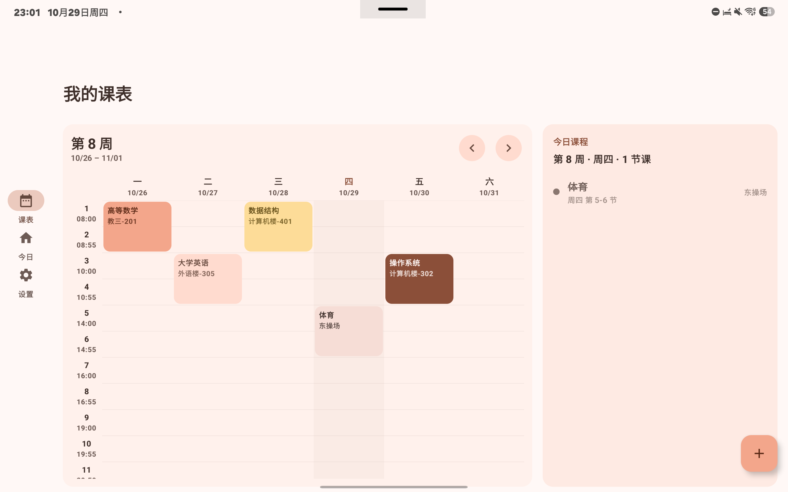
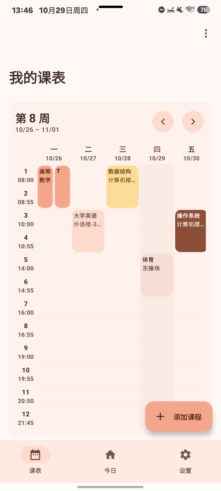

# FallAsleep课程表

一个 Material You（Material 3）风格的 Android 课程表应用：离线、无账号、无后端，手机与平板自适应。

> 当前状态：**M3 进行中** —— M1 数据与课表、M2 教务导入均已通过真机验证；M3 已完成“修改上课时间”（上午/下午节数、自动排课、M3 时间选择器），接下来是上课提醒与桌面小组件。

## 技术栈

- Kotlin 2.3 + Jetpack Compose + Material 3
- `material3-adaptive-navigation-suite`（NavigationBar / Rail / Drawer 自适应）
- minSdk 26，targetSdk / compileSdk 36
- 动态取色（Android 12+）与内置浅色/深色配色回退

## 当前进度

| 阶段 | 内容 | 状态 |
|---|---|---|
| M0 | 工程骨架、M3 主题、自适应导航、真机截图 | ✅ |
| M1 | Room 数据模型、课表网格、课程增删改、多课表、学期设置、导入导出 | ✅ |
| M2 | 教务导入（正方 / 新正方 / 强智 + WebView、重命名、日志） | ✅ 已完成并验证 |
| M3 | 提醒、小组件、ICS/CSV、分享图 | 进行中（已完成：修改上课时间） |
| M4 | 多学期、备份、无障碍、打磨 | 计划中 |

详细环境与验证记录见 [docs/M0-记录.md](docs/M0-记录.md)、[docs/M1-记录.md](docs/M1-记录.md)、[docs/M2-记录.md](docs/M2-记录.md) 与 [docs/M3-记录.md](docs/M3-记录.md)。
界面沟通用的术语见 [docs/UI术语表.md](docs/UI术语表.md)。

## 下载 / 测试版

测试版发布在仓库的 **Releases** 页面：`v0.3.0-beta2`（`app-release.apk`）。

> 包名：`io.github.tukinokilyowsoo.fallasleeptimetable`。从 beta2 起更换了包名，可与旧版并存；数据不互通，需要导出 JSON 再导入。

发布流程与签名备份说明见 [docs/RELEASE-流程.md](docs/RELEASE-流程.md)。

## 构建

```sh
gradle assembleDebug
```

本机（Android + Termux 工具链）的 SDK 路径、Gradle 版本与 `aapt2` 覆盖等特殊配置，见
[docs/M0-记录.md](docs/M0-记录.md)。

## 目录结构

```
app/src/main/java/io/github/fallasleeptimetable/
├── MainActivity.kt
└── ui/
    ├── FallAsleepApp.kt        # 自适应导航壳
    ├── screens/                # 课表 / 今日 / 设置
    └── theme/                  # M3 主题与配色
```

## 截图

| 平板（expanded） | 手机（compact） |
|---|---|
|  |  |

更多：课程详情、今日页、设置、学期设置见 `docs/screenshots/`。

## 说明

- 项目参考了 WakeUp 课程表 3.25 公开代码的功能与交互思路，UI 为重新编写，不使用其图标、资源与品牌名称。
- 仓库目前**没有 LICENSE**，意为保留所有权利；确定许可证后会补充。
